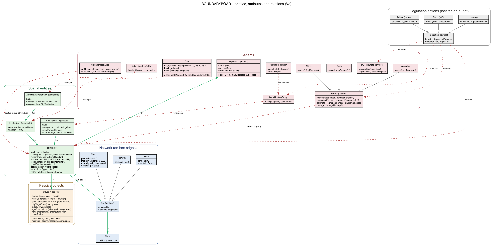
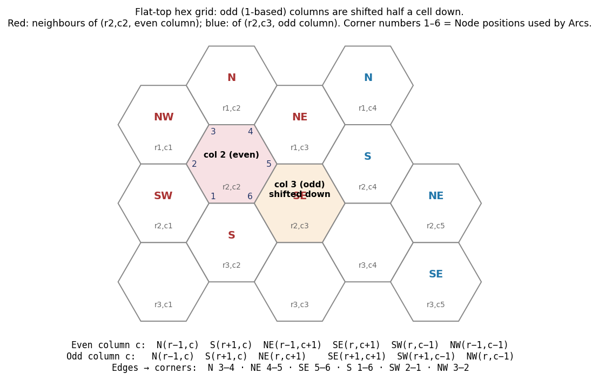
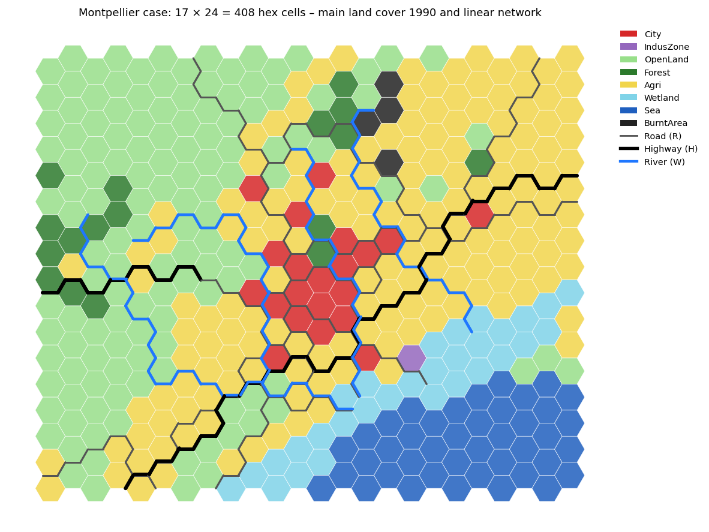
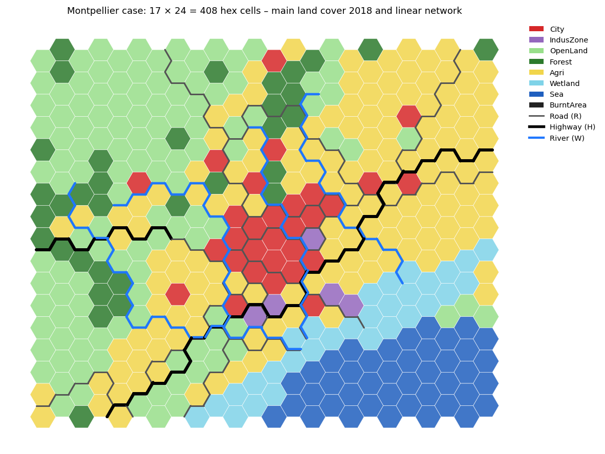
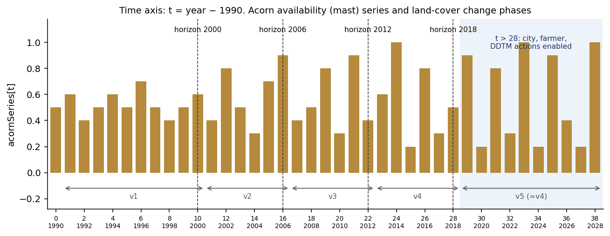
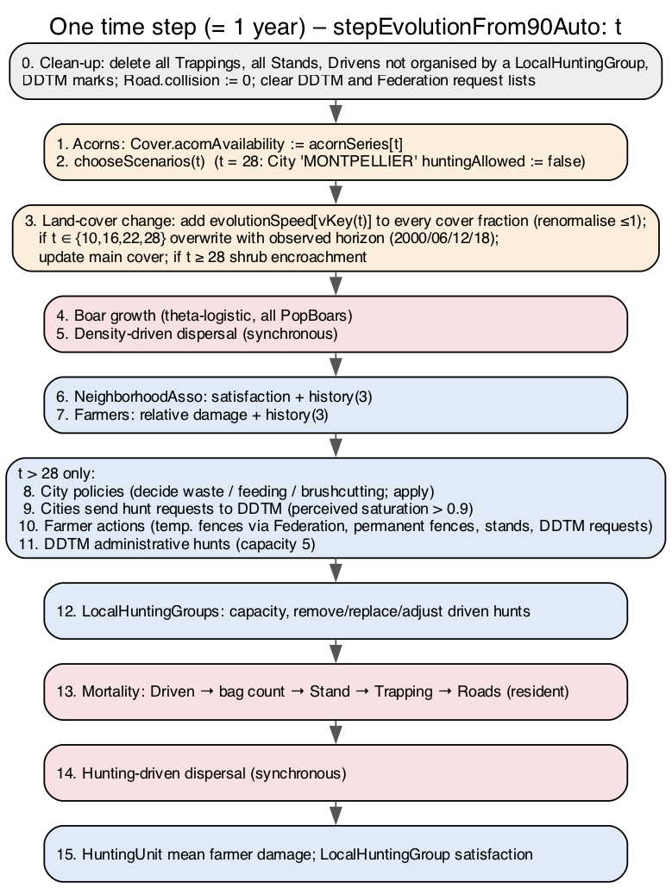
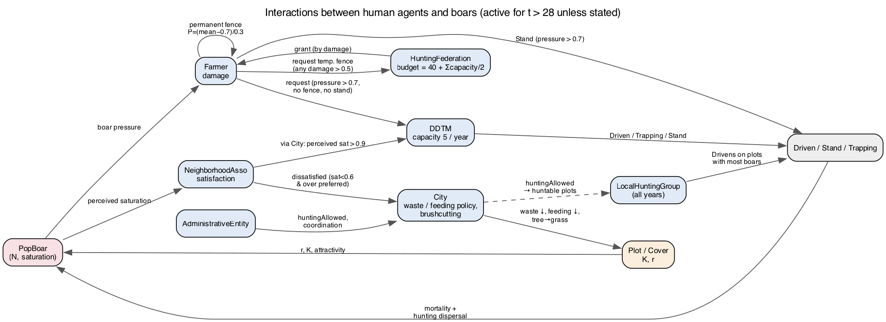
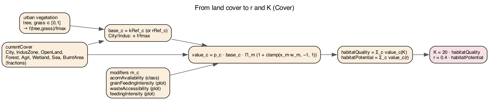
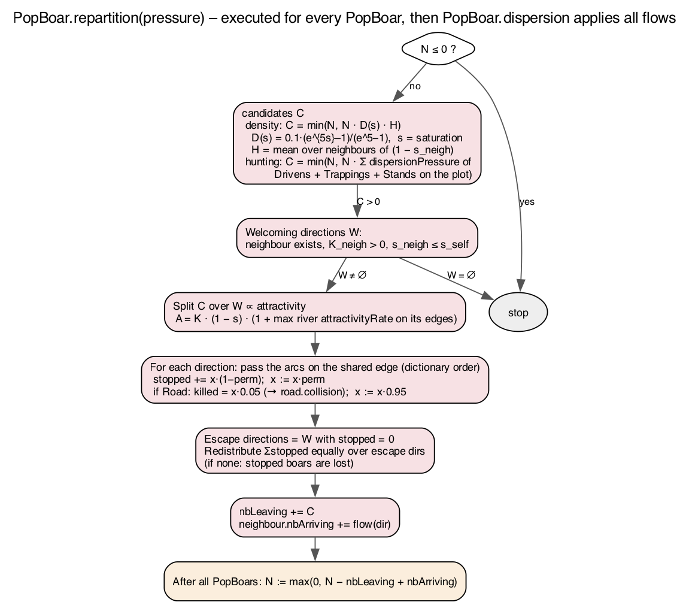
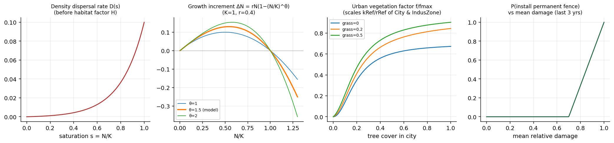

# BOUNDARYBOAR — ODD description of the implementation

*ODD protocol (Grimm et al. 2006, 2010, 2020) written from the source code of the Cormas/VisualWorks model `BOUNDARYBOAR_V3.pst` (version dated 19 Nov 2026, created 25 Mar 2025, Cormas 2025 / VisualWorks 7.6).*

This document aims to let a programmer re-implement the model from scratch on any platform (Python, NetLogo, GAMA, Pharo-Cormas…). Every equation, threshold, parameter value and the exact execution order are taken from the code. Where the code behaves in an unexpected or ambiguous way, this is reported in **§8 Implementation notes and known quirks**. Those points are flagged in the text with ⚠.

Figures are in `img/` (PNG; SVG versions of the Graphviz diagrams are also provided).

---

## Contents

1. Purpose and patterns
2. Entities, state variables and scales
3. Process overview and scheduling
4. Design concepts
5. Initialization
6. Input data
7. Submodels
8. Implementation notes and known quirks
9. Parameter reference table
10. Output variables (probes)
11. Re-implementation checklist / pseudo-code skeleton

---

## 1. Purpose and patterns

**Purpose.** BOUNDARYBOAR is a spatially explicit agent-based model of **wild boar (*Sus scrofa*) population dynamics at the rural–urban interface** of a French Mediterranean metropolis. Two case studies are available: Montpellier (default) and Nîmes. The model couples four components:

* a **habitat component**: land cover that changes from 1990 to 2018 according to observed data and is extrapolated afterwards, together with annual acorn mast and urban food resources (waste, deliberate feeding, urban vegetation). These determine local growth rate *r* and carrying capacity *K*;
* a **boar population component**: one population per cell with theta-logistic growth, density-driven dispersal, hunting-driven dispersal and several mortality sources. Dispersal crosses cell edges that may carry **roads, highways and rivers**, which act as barriers, sources of mortality or attractors;
* a **management component**: driven hunts organised by local hunting groups, stands set up by farmers, and administrative interventions by State services (DDTM: driven hunts, stands, trapping);
* a **social component**: neighbourhood associations, municipalities, farmers, the hunting federation and inter-municipal bodies. These perceive boar pressure and respond with urban policies (waste management, feeding bans, brush-cutting), fences and requests for intervention.

The model studies how management choices made within **administrative and physical boundaries** (municipalities, inter-municipal bodies, hunting units, roads and rivers) shape the colonisation of urban areas by boars and the resulting conflicts.

**Patterns.** The code contains no explicit calibration targets. The following outputs are tracked as probes: total and urban boar numbers, hunting bag, road collisions, number of hunts, fences, farmer damage and association satisfaction. Local population probes for two places (Montferrier, Mosson) suggest that local colonisation patterns were compared with field knowledge.

---

## 2. Entities, state variables and scales



### 2.1 Spatial scale and grid

* The space is a **grid of flat-top hexagonal cells** (`Plot`) with a 6-neighbourhood, **closed** (no wrap-around).
  * Montpellier (`plotMtpBis.csv`): 17 rows × 24 columns = **408 cells**.
  * Nîmes (`plotNimes.csv`): 15 rows × 20 columns = **300 cells**.
* The physical size of a cell is not represented in the code. All quantities are expressed **per cell**: boars per cell, cover fractions of the cell.
* **Neighbour geometry** (verified against the edge data, see `img/04_hex_grid.png`): rows and columns are 1-based, and **odd columns are shifted half a cell down**.

| neighbour | even column *c* | odd column *c* |
|---|---|---|
| N  | (r−1, c)   | (r−1, c)   |
| NE | (r−1, c+1) | (r, c+1)   |
| SE | (r, c+1)   | (r+1, c+1) |
| S  | (r+1, c)   | (r+1, c)   |
| SW | (r, c−1)   | (r+1, c−1) |
| NW | (r−1, c−1) | (r, c−1)   |

* The six **corners** of a hexagon are numbered 1–6. They are used by network nodes:

  | corner | position |
  |---|---|
  | 1 | bottom-left |
  | 2 | left |
  | 3 | top-left |
  | 4 | top-right |
  | 5 | right |
  | 6 | bottom-right |

  Each edge is defined by two corners: N = 3–4, NE = 4–5, SE = 5–6, S = 1–6, SW = 2–1, NW = 3–2.
* Cell identifiers are assumed to be row-major: `id = (row−1)·nCols + col`. This is the Cormas convention and is consistent with the probes.







### 2.2 Temporal scale

* One time step = **one year**. Time is `t = year − 1990`.
* Initialization is at t = 0 (land cover of 1990). The first step is t = 1.
* The land-cover series is observed up to t = 28 (2018). Afterwards it is extrapolated.
* The acorn series is defined for t = 0…38, so a run must stop at **t ≤ 38** (2028). The stored sensitivity analyses used 30 steps.
* Human decision-making (cities, farmers, DDTM) is **switched on only for t > 28**, i.e. it is a 2019–2028 prospective period. Driven hunts by local hunting groups run in every year.



### 2.3 Entities and state variables

Default values are given in brackets. Variables that are declared in the code but never read are listed in §8.5.

#### Plot (spatial cell)

| variable | type | meaning |
|---|---|---|
| `rowIndex`, `colIndex` | int | grid position |
| `huntingUnit` | id → HuntingUnit | hunting unit the cell belongs to |
| `cityName` / `cityTerritory` | string / CityTerritory | municipality |
| `administrativeName` / `administrativeTerritory` | string / AdministrativeTerritory | inter-municipal body (EPCI), e.g. `MMM` = Montpellier Méditerranée Métropole |
| `humanPopDensity` | category | `urbanDense`, `urbanSemiDense`, `ruralLowToVeryLow`, `noPop` |
| `livingStandard` | category | `veryLow`, `low`, `medium`, `high`, `veryHigh`, `NA` |
| `wasteAccessibility`, `initWasteAccessibility` | [0,1] | access of boars to household waste (current and initial) |
| `feedingIntensity`, `initFeedingIntensity` | [0,1] | deliberate feeding of boars by residents (current and initial) |
| `grainFeedingIntensity` | [0,1] [0] | agrainage (supplementary grain feeding); never changed, stays 0 |
| `edgeN … edgeNW` | string | codes of linear features on each edge (`R` road, `H` highway, `W` river; combinations such as `RW`, `RHW`) |
| `arcs` | dir → {type → Arc} | the arcs on each of the 6 edges, at most one per type and edge. The arc object is shared with the neighbour (stored under the opposite direction). |
| `nbDDTMInterventionCity`, `nbDDTMInterventionFarmer` | int [0] | cumulative counts of DDTM interventions triggered by cities and by farmers |
| `natura` | bool | Natura 2000 flag (read from data, not used in dynamics) |
| `currentMainCover` | symbol | land-cover type with the largest fraction (display, initial population) |
| `cover`, `popBoar` | references | its Cover and its PopBoar (1:1) |

#### Cover (passive object, one per Plot)

| variable | meaning |
|---|---|
| `currentCover` | dictionary over the 8 types `City, IndusZone, OpenLand, Forest, Agri, Wetland, Sea, BurntArea` giving the fraction of the cell (sum ≤ 1) |
| `history` | observed fractions at the 5 horizons `#ninety` (1990), `#twoThousand` (2000), `#six` (2006), `#twelve` (2012), `#eighteen` (2018) |
| `evolutionSpeed` | per-period annual change of every fraction: `v1` (1990–2000), `v2` (2000–06), `v3` (2006–12), `v4` (2012–18), `v5` (after 2018, initialised as a copy of `v4`) |
| `cityVegetData` | `{tree, grass}`: tree and herbaceous cover inside urban fabric, in [0,1] |
| `initialCityVegetData` | a copy of `cityVegetData` at initialization |
| `agriComposition` | `{wine, grain, vegetables}`: shares of the agricultural area |
| `nbOfBrushcutting` [0], `brushcuttingYear` | brush-cutting record |
| `coverPolicy` [0] | land-use policy lever (inactive by default) |

Class-level (global) Cover parameters: `r` = 0.4, `k` = 20, `rRefByCover`, `kRefByCover`, `modifiersByCover`, `modifiersValuesByParameter`, `cityVegetParameters`, `historicalInitDensityByCover`, `acornSeries`, `acornAvailability` (the current year's mast value), `maxAcornUrbanReduction` = 0.7, `maxAcornDamageReduction` = 0.7, `shrubEncroachmentRate` = 0. All values are given in §9.

#### Network: Arc (abstract), Road, Highway, River, Node

Arcs lie on hex edges between two `Node`s, each placed at a corner of a cell.

| class | permeability | other |
|---|---|---|
| Road | 0.5 | `mortalityDispersion` = 0.05 (death rate of boars crossing), `mortalityNeighbors` = 0.005 (annual death rate of resident boars), `collision` (number killed this step, reset every step) |
| Highway | 0 | complete barrier |
| River | 1 | `attractivityRate` = 1 (rivers make adjacent cells more attractive) |

#### PopBoar (agent, one per Plot)

| variable | meaning |
|---|---|
| `size` *N* | number of boars (real-valued) |
| `previousSize` | *N* before growth in the current step |
| `nbArriving`, `nbLeaving` | dispersal flow accumulators |

Class parameters (`popDynamicsParameters`): `thetaDensityDep` θ = 1.5, `maxDispRateDensity` = 0.1, `speedDispRateDensity` = 5.

Derived quantities:
* **saturation** `s = clamp(N / K, 0, 1)`; s = 1 if K ≤ 0.
* **urbanUseFactor** `= 1 − 0.7·a²`, where *a* = acornAvailability.
* **agriculturalUseFactor** `= 1 − 0.7·a²`.

#### Aggregates

* `CityTerritory`: cells sharing `cityName`. Managed by one **City**.
* `AdministrativeTerritory`: city territories sharing `administrativeName`. Managed by one **AdministrativeEntity**.
* `HuntingUnit`: cells sharing `huntingUnit`. Managed by one **LocalHuntingGroup**. It also stores:
  * `meanFarmerDamage`;
  * `tenYearsBagCount`, the last ≤ 10 annual driven-hunt bags.

#### Human agents

| agent | number | state |
|---|---|---|
| **City** (municipality) | 1 per CityTerritory | `wastePolicy`, `feedingPolicy` ∈ {0, 0.25, 0.5, 0.75, 1} [0]; `huntingAllowed` [true]; `nbBrushcuttingCampaigns` [0]; `coverPolicy` [0]; `priority` [#anthropoFood] (not used) |
| **AdministrativeEntity** (EPCI) | 1 per AdministrativeTerritory | `huntingAllowed` [true], `coordination` [false] |
| **NeighborhoodAsso** (residents' association) | 1 per cell whose **2018** City fraction > 0.3 | `profil` = shares of three attitude profiles `{coexistence, ambivalent, worried}`; `satisfaction` ∈ [0,1]; `satisfactionHistory` (last 3 values) |
| **Farmer**, abstract, with subclasses **Wine**, **Grain**, **Vegetable** | 0–3+ per cell with agriculture | `representedSurface` (fraction of the cell); `damageSensitivity`; `temporaryFences`, `permanentFences` ∈ {0,1}; `canInstallPermanentFences` (bool); `standsAuthorized` [true]; `damage` ∈ [0,1]; `damageHistory` (last 3 values) |
| **LocalHuntingGroup** (ACCA / hunting society) | 1 per HuntingUnit | `huntingCapacity` (int), `satisfaction` |
| **HuntingFederation** | 1 | `budget` = `{state, hunters}`, `farmerRequest` (list), `components` = all LocalHuntingGroups |
| **DDTM** (State services) | 1 | `interventionCapacity` = 5 per year, `cityRequest` (list of plots), `farmerRequest` (list of farmers) |

#### Regulation actions (located on a Plot)

Abstract class `Regulation`: `lethality`, `dispersionPressure`, `nbBoarsKilled` [0], `organizer`.

| class | lethality | dispersionPressure | who creates it |
|---|---|---|---|
| **Driven** (driven hunt / *battue*) | 0.1 | 0.3 | LocalHuntingGroup, DDTM |
| **Stand** (stand hunting / *affût*) | 0.4 | 0.1 | Farmer, DDTM |
| **Trapping** | 0.7 | 0.05 | DDTM |

`DDTMRegulation` is an empty marker agent placed on cells where the DDTM intervened (used only for display).

---

## 3. Process overview and scheduling

The main step method is `stepEvolutionFrom90Auto: t`. All loops over a collection run over every member in collection order. No random ordering is used.



```
step(t):
 0. CLEAN-UP
    delete every Trapping; delete every Driven whose organizer is NOT a LocalHuntingGroup;
    delete every Stand; delete DDTMRegulation markers;
    every Road.collision := 0;
    DDTM.farmerRequest := []; DDTM.cityRequest := []; HuntingFederation.farmerRequest := []
 1. Cover.acornAvailability := acornSeries[t]                       (§7.1)
 2. chooseScenarios(t)                                              (§7.12)
 3. coverEvolution(t)                                               (§7.2)
 4. popBoarsGrowth: all PopBoars previousSize := N; then each grows (§7.4)
 5. popBoarDensityMovement: synchronous dispersal, pressure #density (§7.5)
 6. for each NeighborhoodAsso: setSatisfaction; updateSatisfactionHistory (§7.7)
 7. for each Farmer: relativeDamage; updateDamageHistory            (§7.8)
 8. if t > 28: applyCityPolicies                                    (§7.9)
 9. if t > 28: each City requestHuntDDTM                            (§7.11)
10. if t > 28: farmerActions                                        (§7.8)
11. if t > 28: ddtmActions (organizeAdministrativeHunt)             (§7.11)
12. localHuntingGroupsActions(t)                                    (§7.10)
13. boarMortality                                                   (§7.6)
14. popBoarHuntingMovement: synchronous dispersal, pressure #hunting (§7.5)
15. each HuntingUnit setMeanFarmerDamage; each LocalHuntingGroup setSatisfaction
```

Other step methods:
* `stepExample` is used with the toy landscape `initExample`. It runs steps 0 (roads only), 4, 5, 13, 14, 6, 7 and 15.
* `stepEvolutionFrom90Manual: t` is the participatory/game mode, in which the user places hunts through the interface. It is broken in V3, see §8.4.

---

## 4. Design concepts

* **Basic principles.**
  * Population growth is theta-logistic with a carrying capacity built from habitat composition.
  * Dispersal is density-dependent (an exponential function of saturation) and is redirected by landscape resistance: arcs with a permeability.
  * Disturbance (hunting) causes extra dispersal, i.e. a "dispersion pressure" displaces boars.
  * Urban colonisation is driven by anthropogenic food (waste, feeding) and by urban vegetation, and is modulated by the natural food supply (acorn mast years push boars back into the forest).
  * Human agents respond to perceived boar pressure through bounded-rational, threshold-based rules.
* **Emergence.** The following emerge from local growth, dispersal, mortality and agents' responses: the spatial spread of boars into urban areas, hunting bags, road collisions, the number and location of fences, hunts and interventions, and the level of each city's policy.
* **Adaptation.**
  * Cities choose the policy that minimises the projected number of urban boars, net of cost.
  * Hunting groups relocate their least efficient hunts to cells with the most boars.
  * Farmers request or install fences and set up stands when damage or pressure exceeds thresholds.
* **Objectives.**
  * Cities: score = projected reduction in urban boars − 0.05 × policy cost.
  * Hunting groups: kill boars where they are most abundant.
* **Learning.** None. Memories are 3-year histories of damage and satisfaction, and a 10-year history of hunting bags.
* **Prediction.** Cities make a **one-step-ahead projection** of urban boar numbers with the growth equation under each candidate policy (§7.9).
* **Sensing.**
  * Associations perceive the urban part of the local boar population, relative to its maximum.
  * Farmers perceive the agricultural part of the local population.
  * Hunting groups know the boar numbers of all cells in their unit.
  * The DDTM knows request priorities (saturation, damage).
* **Interaction.**
  * Boars interact indirectly through saturation and attractivity of neighbouring cells.
  * Humans affect boars through habitat modifiers (waste, feeding, vegetation) and through regulation agents (mortality and dispersal).
  * Requests flow from associations (through their city) and from farmers to the DDTM and the federation.

  

* **Stochasticity.** Only one random draw exists: the probability of installing a permanent fence (`Cormas random`, uniform on [0,1)). The eligibility of a farmer for permanent fences is pseudo-random but deterministic (based on its id, §7.8). Everything else is deterministic.
* **Collectives.**
  * The HuntingFederation groups all LocalHuntingGroups.
  * The AdministrativeEntity groups cities.
  * The aggregates (CityTerritory, AdministrativeTerritory, HuntingUnit) are spatial collectives.
* **Observation.** See §10.

---

## 5. Initialization

The init method is `initMtp90` (Montpellier) or `initNimes90` (Nîmes); `initExample` is a toy case.

```
initMtp90:
  initSpaceMtp(#ninety)
  initAgents
```

### 5.1 `initSpace(horizon = #ninety)`

1. `Plot.initialize` (class): set the predictor weights.
   * wasteAccessPredictors: {density: 0.6, livingStandard: 0.4}.
   * feedingIntensityPredictors: {density: 0.3, coexistence: 0.7}.
2. **createPlotsFromFile** (`plotMtpBis.csv`):
   * the grid size is the maximum of `colIndex` and `rowIndex`;
   * create a flat-top hex grid with 6-neighbourhood, closed;
   * for each row, set on the matching plot: `natura`, `administrativeName`, `cityName`, `huntingUnit`, `placeName`, `humanPopDensity`, `livingStandard` and the six edge codes;
   * compute `wasteAccessibility = initWasteAccessibility` and `feedingIntensity = initFeedingIntensity` (§7.3);
   * initialise an empty `arcs` dictionary for each of the six directions.
3. **createCoversFromFile** (`coverMtpBis.csv`), for every plot:
   1. Create a Cover.
   2. Fill `history[h][type]` from the columns `cover<Type>_<suffix>` (suffixes 90, 00, 06, 12, 18). In the CSV the decimal separator is a comma, and an empty field means nil.
   3. `currentCover := history[#ninety]` (⚠ the same dictionary object, not a copy; see §8.6). Set `currentMainCover` to the type with the largest fraction.
   4. Set `agriComposition` = {wine, grain, vegetables} from the columns `wine`, `grain`, `vegetable`. A nil value becomes 0.
   5. Set `cityVegetData` = `initialCityVegetData` = {tree: `treeCity`, grass: `grassCity`}. These can be nil for non-urban cells.
   6. **evolutionSpeeds**: for i = 1..4, take horizons h_i → h_{i+1} with years 1990, 2000, 2006, 2012, 2018:
      `v_i[type] = (history[h_{i+1}][type] − history[h_i][type]) / (year_{i+1} − year_i)`.
      Then `v5 := copy(v4)`.
4. `Cover.initialize` (class): set the reference tables, modifiers, urban-vegetation parameters and acorn series (§9), and `acornAvailability := acornSeries[0]` = 0.5.
5. Create the aggregates:
   * **CityTerritories**, grouping plots by `cityName`;
   * **AdministrativeTerritories**, grouping CityTerritories by `administrativeName`;
   * **HuntingUnits**, grouping plots by `huntingUnit`.
   Each plot stores references to its aggregates.
6. **initArcs**: for each plot, in id order, and for each direction dir ∈ (N, NE, SE, S, SW, NW), for each character of `edge<dir>` (R → Road, W → River, H → Highway):
   * if the neighbour in that direction exists **and** the neighbour does not already have an arc of that type on the opposite edge, create one arc on this cell between the two corners of the edge (§2.1);
   * register it in `self.arcs[dir][type]` **and** in `neighbour.arcs[opposite(dir)][type]`.
   * The input files list every edge feature on both adjacent cells. Thanks to this test, each physical edge gets exactly one arc per type.

   Finally, initialise permeabilities: Road 0.5, Highway 0, River 1.

### 5.2 `initAgents`

1. **PopBoars** (one per plot). Let *U* = true if the plot or any of its neighbours has `currentMainCover` ∈ {City, IndusZone}.
   * If *U*: `N₀ = 0`.
   * Otherwise:
     `N₀ = k · (Forest₉₀ · kRef_Forest · 0.02 + OpenLand₉₀ · kRef_OpenLand · 0.01) = 20 · (0.03·Forest + 0.008·OpenLand)`.
     For example, a 100 % forest cell gets 0.6 boars.
   * Set `nbArriving = 0` and `previousSize = N₀`.

   Then `PopBoar.initialize` (class): θ = 1.5, maxDispRateDensity = 0.1, speedDispRateDensity = 5.
2. **Cities**: one per CityTerritory (`ct.manager := city`). Then `City.initialize` sets policyCosts {0.25→1, 0.5→2, 0.75→4, 1.0→8}. Every city starts with `priority = #anthropoFood`, `wastePolicy = feedingPolicy = 0` and `nbBrushcuttingCampaigns = 0`.
3. **AdministrativeEntities**: one per AdministrativeTerritory.
4. **Farmers**, per plot, with `A = Agri` fraction at 1990:
   * If A ≤ 0, create none.
   * `totalFarmers = 1 + floor(A · (maxFarmersPerPlot − 1))`, with maxFarmersPerPlot = 3, so the result is 1, 2 or 3.
   * For each activity (wine, grain, vegetables) with share `p ≥ 0.05` in `agriComposition`:
     * `nbAgents = max(1, round(p · totalFarmers))`;
     * create `nbAgents` agents of class Wine / Grain / Vegetable, each with `representedSurface = p · A / nbAgents`.
   * On creation, a farmer sets `damageSensitivity` (Wine 0.5, Grain 0.4, Vegetable 0.9).
   * `canInstallPermanentFences = ((id mod 100)/100 < probabilityFencing)`, with probabilityFencing = Wine 0.6, Grain 0.2, Vegetable 0.8.
   * Afterwards, `Farmer.initialize` (class) sets fenceEfficiency {permanent: 0.9, temporary: 0.3}.
5. **NeighborhoodAssos**: one on each plot with `history[#eighteen][City] > 0.3`. Note that the 2018 map is used even when starting in 1990.
   * Plots of administrative territory `MMM`: profile {ambivalent 0.2, worried 0.3, coexistence 0.5}.
   * Other plots: {ambivalent 0.5, worried 0.4, coexistence 0.1}.

   `NeighborhoodAsso.initialize` (class) sets preferedDensityByProfil {coexistence 0.5, ambivalent 0.2, worried 0}. Each association then computes its satisfaction once and records it in its history.
6. **DDTM**: one agent, with `interventionCapacity := 5`.
7. **HuntingFederation**: one agent; `components` = the collection of LocalHuntingGroups. In the original code the collection object is shared, so it gets filled at the next stage.
8. **LocalHuntingGroups**: one per HuntingUnit (`hu.manager := lhg`). Then `LocalHuntingGroup.initialize` (class):
   * historicalHuntingStrategy {minDrivens 0.025, maxDrivens 0.9, displacedDrivens 0.1};
   * weightSatisfaction {harvest 0.6, farmerDamage 0.4}.

No regulation agent exists at t = 0.

---

## 6. Input data

All files are `;`-separated with a header row. Rows/columns are 1-based. Decimals in the cover files use a comma. The files are in `data/` (Cormas `dataPath`).

### 6.1 Plot file (`plotMtpBis.csv`, `plotNimes.csv`, `exPlot.csv`)

```
fid;rowIndex;colIndex;natura;huntingUnit;edgeN;edgeNE;edgeSE;edgeS;edgeSW;edgeNW;placeName;humanPopDensity;livingStandard;cityTerritory;administrativeTerritory
```

* `natura`: `true` or `false`.
* `edge*`: an empty string, or any combination of the letters `R`, `H`, `W`.

Montpellier summary:
* 5 hunting units, 92 municipalities;
* administrative territories: MMM (125 cells), CCGrdPicStLoup, CCValleeHerault, CAPaysOr, CASete, CALunel, NA.

### 6.2 Cover file (`coverMtpBis.csv`, `coverNimes.csv`, `exCover.csv`)

```
fid;rowIndex;colIndex;
coverCity_90;coverIndusZone_90;coverOpenLand_90;coverForest_90;coverAgri_90;coverWetland_90;coverSea_90;coverBurntArea_90;
… same 8 columns for _00, _06, _12, _18 …
treeCity;grassCity;wine;grain;vegetable
```

* Fractions are of the cell area.
* `treeCity` and `grassCity` are the tree and grass cover within urban fabric, in [0,1].
* `wine`, `grain` and `vegetable` are the shares of the agricultural area.
* In the Montpellier file, every cell that is ever urban has `treeCity` filled in.

### 6.3 Hard-coded series

* `acornSeries[0..38]` (year 1990 + t):

```
t : 0   1   2   3   4   5   6   7   8   9  10  11  12  13  14  15  16  17  18  19
a : .5  .6  .4  .5  .6  .5  .7  .5  .4  .5  .6  .4  .8  .5  .3  .7  .9  .4  .5  .8
t : 20  21  22  23  24  25  26  27  28  29  30  31  32  33  34  35  36  37  38
a : .3  .9  .4  .6  1.0 .2  .8  .3  .5  .9  .2  .8  .3  1.0 .2  .9  .4  .2  1.0
```

* Horizon transitions: t = 10 → 2000, t = 16 → 2006, t = 22 → 2012, t = 28 → 2018.

`maps/cover_MTP.env` is an older Cormas grid file (17 × 24, an attribute `coverNum`). The V3 initialisation does not use it.

---

## 7. Submodels

Notation:
* *p_c* = `currentCover[c]`, the fraction of cover type *c*;
* *a* = `Cover.acornAvailability`;
* clamp(x, lo, hi) = min(max(x, lo), hi).

### 7.1 Acorn availability

`Cover.acornAvailability := acornSeries[t]`. This is done in step 1, and again inside `coverEvolution`, with the same value. It is a global value, shared by all cells.

### 7.2 Land-cover evolution (`coverEvolution(t)`)

```
vKey = v1 if t ≤ 10; v2 if t ≤ 16; v3 if t ≤ 22; v4 if t ≤ 28; v5 if t ≤ 38; else none
if vKey: for each cover: applyEvolutionForKey(vKey)
if t ∈ {10,16,22,28}: for each cover: currentCover := copy(history[horizon(t)])
for each plot: currentMainCover := argmax_c p_c
acornAvailability := acornSeries[t]
if t ≥ 28: for each cover: shrubEncroachment
```

**applyEvolutionForKey(vKey)** for one cover, with speed = evolutionSpeed[vKey]:

```
for each type c:  new_c = clamp(p_c + speed_c, 0, 1)
total = Σ new_c
if total > 1:
   excess = total − 1
   I = {c : speed_c > 0};  S = Σ_{c∈I} speed_c
   for c in I: new_c = new_c − excess · speed_c / S
p_c := new_c for all c
```

A total below 1 is left as it is.

**projectionEvolution** is called on every cover in every step with t > 28:
`v5[c] := v4[c] · (1 − 2·coverPolicy)`.
coverPolicy is always 0 in the current code, so v5 = v4.

**shrubEncroachment** applies when `grass` is not nil and `grass > 0.2 · initialGrass`:
* `tree += shrubEncroachmentRate`;
* `grass = max(0, grass − shrubEncroachmentRate)`.

The default rate is 0, so this has no effect by default.

### 7.3 Habitat: growth potential *r* and carrying capacity *K*



**Plot-level anthropogenic food** (computed once at initialization; changed later only by city policies):

| humanPopDensity | densityScore (waste) | feedingDensityScore (feeding) |
|---|---|---|
| urbanDense | 1.0 | 1.0 |
| urbanSemiDense | 0.8 | 0.6 |
| ruralLowToVeryLow | 0.5 | 0.3 |
| other (`noPop`, …) | 0 | 0 |

| livingStandard | veryLow | low | medium | high | veryHigh | other |
|---|---|---|---|---|---|---|
| livingScore | 1.0 | 0.8 | 0.6 | 0.4 | 0.2 | 0 |

```
initWasteAccessibility  = min(1, 0.6·densityScore + 0.4·livingScore)
initFeedingIntensity    = min(1, 0.3·feedingDensityScore + 0.7·coexistenceScore)
```

`coexistenceScore` is the `coexistence` share of the profile of the NeighborhoodAsso on the plot, or 0 if there is none. ⚠ In the code this is evaluated **before** associations exist, so it is always 0, and `initFeedingIntensity = 0.3·feedingDensityScore` (§8.2).

**Urban vegetation function** (used for City and IndusZone). Let `tree` and `grass` be clamped to [0,1], with T_tree = 0.2, T_veg = 0.15, w_tree = 0.7 and w_veg = 0.3.

```
treeTerm = tree² / (tree² + T_tree²)
vegTerm  = tree·grass / (tree·grass + T_veg)
f        = w_tree·treeTerm + w_veg·vegTerm ;   fmax = w_tree + w_veg = 1
urbanVegetationScore = f
```

The same expression is used to scale the reference values of urban covers by f / fmax.

**Base value per cover type.** For X ∈ {K, r}:

```
if p_c ≤ 0:                base_c = 0
elif c ∈ {City, IndusZone}: base_c = XRef_c · f/fmax
else:                       base_c = XRef_c
```

| c | kRef | rRef |
|---|---|---|
| Forest | 1.5 | 1.0 |
| OpenLand | 0.8 | 0.9 |
| Agri | 0.4 | 0.9 |
| Wetland | 0.5 | 0.8 |
| BurntArea | 0 | 0.2 |
| Sea | 0 | 0 |
| City | 0.2 | 0.7 |
| IndusZone | 0.1 | 0.5 |

**Modifiers.** Each cover type has a list of modifier variables. Each variable *m* has a weight w(X, m):

| c | modifiers |
|---|---|
| City | wasteAccessibility, feedingIntensity |
| IndusZone | wasteAccessibility |
| OpenLand, Forest, Wetland | acornAvailability, grainFeedingIntensity |
| Agri | acornAvailability, grainFeedingIntensity, temporaryFencesIntensity, permanentFencesIntensity |
| Sea, BurntArea | — |

| modifier m | w(K, m) | w(r, m) | value x_m taken from |
|---|---|---|---|
| acornAvailability | 0.20 | 0.50 | Cover class (global *a*) |
| grainFeedingIntensity | 0.20 | 0.25 | Plot (always 0) |
| wasteAccessibility | 0.50 | 0.15 | Plot |
| feedingIntensity | 0.50 | 0.15 | Plot |
| temporaryFencesIntensity | 0 ⚠ | 0 ⚠ | Plot: Σ farmers representedSurface·temporaryFences |
| permanentFencesIntensity | 0 ⚠ | 0 ⚠ | Plot: Σ farmers representedSurface·permanentFences |

⚠ The weight table defines `temporaryFences` and `permanentFences` (−0.2 for K, −0.1 for r), but the modifier lists use the names `…FencesIntensity`. The look-up therefore falls back to 0, so **fences currently have no effect on r and K** (§8.1).

**Value of one cover type and totals:**

```
value_c(X) = p_c · base_c(X) · Π_{m ∈ modifiers(c)} (1 + clamp(x_m · w(X,m), −1, 1))

habitatQuality   = Σ_c value_c(K)
habitatPotential = Σ_c value_c(r)

K = k · habitatQuality       (k = 20)      → Cover.carryingCapacity
r = r₀ · habitatPotential    (r₀ = 0.4)    → Cover.growthPotential
```

Example: a pure forest cell with a = 0.5 gives K = 20·1.5·1.1 = 33 and r = 0.4·1.0·1.25 = 0.5.

A plot is **suitable for boars** if K > 0. It is **suitable for hunting** if it is suitable for boars and `City + IndusZone < 0.5`. It is **huntable** if it is suitable for hunting and its city's `huntingAllowed` is true.

**Share of the population in a cover type** (used by associations and farmers):

```
cityShare(N) = N · value_City(K) / habitatQuality              (0 if habitatQuality ≤ 0)
urbanBoars   = cityShare(N) · urbanUseFactor
maxUrbanBoars = cityShare(K) · urbanUseFactor
localBoars (farmer)    = N · value_Agri(K) / habitatQuality
maxLocalBoars (farmer) = K · value_Agri(K) / habitatPotential  ⚠ (r-based denominator, §8.3)
urbanUseFactor = agriculturalUseFactor = 1 − 0.7·a²
```

**Plot attractivity** (for dispersal):

```
attractivity = K · (1 − s) · (1 + maxRiver)
```

`maxRiver` is the largest `attractivityRate` among the River arcs on any of the plot's edges (1 if the plot borders a river, else 0).

### 7.4 Boar growth

For each PopBoar, after all of them have stored `previousSize := N`:

```
if K > 0:  N := N + r · N · (1 − (N/K)^θ)        θ = 1.5
```

There is no clamp, so N can become negative when N ≫ K. It is clamped to 0 at the next dispersion (§8.7).

### 7.5 Dispersal (`repartition(pressure)` and `dispersion`)



Dispersal is **synchronous**:

1. Every PopBoar resets `nbArriving = nbLeaving = 0`.
2. Every PopBoar computes its outgoing flows from the current N values. These are not modified during this phase.
3. Every PopBoar applies `N := max(0, N − nbLeaving + nbArriving)`.

The procedure runs twice per step: with `pressure = #density` after growth, and with `pressure = #hunting` after mortality.

```
repartition(pressure):
  if N ≤ 0: return
  # 1 candidates
  if pressure = #density:
      s = saturation
      D = maxDispRate · (exp(speed·s) − 1) / (exp(speed) − 1)            # 0.1, 5
      H = mean over existing neighbours n of (1 − s_n)                 # 0 if none
      C = min(N, N · D · H)
  if pressure = #hunting:
      P = Σ dispersionPressure of all Driven, Trapping and Stand agents on this plot
      C = min(N, N · P)
  if C ≤ 0: return
  # 2 welcoming neighbours
  W = {dir : neighbour exists, neighbour.K > 0, neighbour.s ≤ self.s}
  if W = ∅: return
  A_tot = Σ_{dir∈W} attractivity(neighbour_dir)
  if A_tot ≤ 0: return
  flow[dir] = attractivity(neighbour_dir) / A_tot · C
  # 3 crossing the edge
  for dir in W:
      x = flow[dir]; stopped[dir] = 0; killed[dir] = 0
      for each arc (type, arc) on edge dir:            # dictionary order, see §8.8
          stopped[dir] += x · (1 − perm);   x = x · perm
          if type = Road:
              k = x · 0.05;  arc.collision += k;  killed[dir] += k;  x = x · 0.95
      flow[dir] = x
  # 4 redistribution of stopped animals
  E = {dir ∈ W : stopped[dir] = 0}
  if E ≠ ∅ and Σ stopped > 0:
      for dir in E: flow[dir] += Σ stopped / |E|
  # 5 book-keeping
  nbLeaving += C
  for dir in W: neighbour_dir.nbArriving += flow[dir]
```

Consequences:
* Boars killed on roads disappear.
* Boars stopped by a barrier move to edges without a blocking arc. If there are none, they **disappear**, because they count as leaving but arrive nowhere (§8.9).
* Redistributed boars do not test arcs again. Their edges have no Road or Highway by construction.

### 7.6 Mortality (`boarMortality`)

```
for each Driven d (in theDrivens): d.nbBoarsKilled = N(d.plot) · 0.1
for each HuntingUnit: setTenYearsBagCount     # Σ nbBoarsKilled of Drivens on its plots, appended; keep last 10
for each PopBoar: N -= Σ nbBoarsKilled of Drivens on its plot; N = max(0, N)
for each Stand s (in theStands):
    if N(plot) ≤ 0: skip
    exposed = (organizer is Farmer) ? organizer.localBoars · organizer.representedSurface : N(plot)
    s.nbBoarsKilled = min(N(plot), exposed · 0.4)
for each PopBoar: N -= Σ nbBoarsKilled of Stands on its plot; N = max(0, N)
for each Trapping tr: tr.nbBoarsKilled = N(plot) · 0.7
for each PopBoar: N -= Σ nbBoarsKilled of Trappings on its plot; N = max(0, N)
for each PopBoar: for each Road occupying its plot: k = N · 0.005; road.collision += k; N -= k
```

Notes:
* Several Drivens on the same plot (one from the hunting group, one from the DDTM) each kill 10 % of the same pre-hunt N.
* "Road occupying its plot": in Cormas an arc is an occupant of the cell(s) on which its nodes lie. Each road segment was created by the first of its two adjacent plots in id order. For a re-implementation, attribute each road edge to the adjacent plot with the lower id (§8.10).
* ⚠ DDTM-created regulation agents are probably **not** in `theDrivens`/`theStands`/`theTrappings` (§8.11).

### 7.7 Neighbourhood associations

```
preferredSaturation = 0.5·profil.coexistence + 0.2·profil.ambivalent + 0·profil.worried
     → 0.29 for MMM associations, 0.15 elsewhere
perceivedSaturation = urbanBoars / maxUrbanBoars      (= N/K, not clamped; see §8.12)
satisfaction        = clamp(1 − |perceivedSaturation − preferredSaturation|, 0, 1)
satisfactionHistory: append, keep last 3
```

An association is **dissatisfied** when `satisfaction < 0.6` (`dissatisfactionThreshold`) **and** `perceivedSaturation > preferredSaturation`.

### 7.8 Farmers and the hunting federation

**Damage** (step 7, every year):

```
boarPressure     = localBoars · damageSensitivity · representedSurface · agriculturalUseFactor
maxBoarPressure  = maxLocalBoars · damageSensitivity · representedSurface
protection       = min(1, 0.9·permanentFences + 0.3·temporaryFences)
standEffect      = min(0.5, dispersionPressure of a Stand on its plot organised by itself) else 0   (= 0.1)
absoluteDamage   = max(0, boarPressure · (1 − protection) · (1 − standEffect))
damage           = maxBoarPressure ≤ 0 ? (unchanged; method returns 0) : min(1, absoluteDamage / maxBoarPressure)
damageHistory: append, keep last 3
```

⚠ Stands are deleted at the start of each step (step 0), before damage is computed. So `standEffect` is always 0 in the automatic schedule.

**farmerActions** (t > 28), in this order:

1. For each farmer:
   * `temporaryFences := 0`;
   * if `permanentFences ≠ 1` and any value in `damageHistory` is > 0.5, add itself to `HuntingFederation.farmerRequest`.
2. HuntingFederation `setBudget`: `budget.state = 40`, `budget.hunters = (Σ huntingCapacity of all LocalHuntingGroups) / 2`. The capacities are the values set in the previous step's step 12.
3. HuntingFederation `grantTemporaryFences`:
   * `B = state + hunters`;
   * for the requesting farmers, sorted by `damage` descending: if B ≤ 0, stop; otherwise `farmer.temporaryFences := 1` and `B := B − 1`.
4. For each farmer:
   * **installPermanentFences**: if `temporaryFences ≠ 1`:
     * `m = mean(damageHistory)`;
     * `P = clamp((m − 0.7)/0.3, 0, 1)`;
     * if `U(0,1) < P` and `canInstallPermanentFences`: `permanentFences := 1`. This is permanent.
   * **organizeStand**: if `standsAuthorized`, `maxBoarPressure > 0`, `boarPressure/maxBoarPressure > 0.7` and `permanentFences = 0`: create a Stand on its plot with lethality 0.4, pressure 0.1 and organizer = this farmer.
   * **requestHuntDDTM**: if `maxBoarPressure > 0`, `boarPressure/maxBoarPressure > 0.7`, `permanentFences = 0` and the farmer has no own Stand on the plot: add itself to `DDTM.farmerRequest`. Because the stand was created just before, this applies only when stands are not authorized.

`canInstallPermanentFences` is set at creation as `(id mod 100)/100 < probabilityFencing`. A re-implementation can use `U(0,1) < probabilityFencing` with a seeded generator.

### 7.9 City policies (`applyCityPolicies`, t > 28)

```
1. for each City: decidePolicy
2. for each Cover: projectionEvolution          (§7.2)
3. for each AdministrativeEntity:
      applyHuntingPolicy: for each city of its territory, if city.huntingAllowed then city.huntingAllowed := ae.huntingAllowed
      if coordination: coordinatePolicy(wastePolicy); coordinatePolicy(feedingPolicy)
          max = max over its cities of the policy; any city below (max − 0.25) is raised to (max − 0.25)
4. for each City: applyFeedingPolicy; applyWastePolicy
      for each plot of its territory:
          feedingIntensity   = initFeedingIntensity   · (1 − feedingPolicy)
          wasteAccessibility = initWasteAccessibility · (1 − wastePolicy)
```

**decidePolicy (City):**

```
if no association of the city is dissatisfied (§7.7): return
scenarios = []
if wastePolicy   < 1: add #waste
if feedingPolicy < 1: add #feeding
if priorityPlotsForBrushcutting ≠ ∅: add #brushcutting
if scenarios = ∅: return
baseline = projectedUrbanPopulation(#none)
best = #none; bestScore = 0
for sc in scenarios (order: waste, feeding, brushcutting):
    score = (baseline − projectedUrbanPopulation(sc)) − 0.05 · cost(sc)
    if score > bestScore: best = sc; bestScore = score
#waste        → wastePolicy   += 0.25
#feeding      → feedingPolicy += 0.25
#brushcutting → nbBrushcuttingCampaigns += 1; brush-cut the priority plots (below)
```

The cost of the next policy level is `policyCosts[min(level + 0.25, 1)]` with {0.25: 1, 0.5: 2, 0.75: 4, 1.0: 8}. The cost of brush-cutting is 0.

**projectedUrbanPopulation(sc)** = Σ over the city's plots of `projectedUrbanBoars(plot, sc)`:

```
if p_City ≤ 0: 0
ov  = overrides(plot, sc)
r'  = 0.4 · habitatPotential(ov);  K' = 20 · habitatQuality(ov)
N'  = (K' ≤ 0) ? N : N + r'·N·(1 − (N/K')^θ)
HQ' = habitatQuality(ov);  if HQ' ≤ 0: 0
urbanK' = value_City(K) with ov
return N' · urbanK' / HQ' · urbanUseFactor
```

`overrides(plot, sc)` replaces some input values during evaluation:
* `#waste`: `wasteAccessibility = initWasteAccessibility · (1 − min(1, wastePolicy + 0.25))`.
* `#feeding`: `feedingIntensity = initFeedingIntensity · (1 − min(1, feedingPolicy + 0.25))`.
* `#brushcutting`: only if the plot is a priority plot with non-nil grass and tree > 0. Then, with `cut = min(0.05, tree)`, `tree = tree − cut` and `grass = grass + cut`. These replace the urban-vegetation inputs of the City and IndusZone base values.
* `#none`: no override.

**priorityPlotsForBrushcutting**:
* candidates are plots with `City + IndusZone > 0.3` and `urbanVegetationScore > 0.5` (`brushcuttingThreshold`);
* sort them by score, descending;
* take the first `max(1, ceil(0.2 · |candidates|))`, or none if there are no candidates.

**applyBrushcuttingPolicy**: for each priority plot with non-nil grass:
* if tree > 0: `cut = min(0.05, tree)`, `tree −= cut`, `grass += cut`;
* `brushcuttingYear = current t`;
* `nbOfBrushcutting += 1`.

### 7.10 Local hunting groups (every year, step 12)

```
for each LHG:
  huntingCapacity = |potentialPlotsHunt|        # huntable plots of its HuntingUnit (§7.3)
  updateDrivenHuntsAt(t):
    1. removeDrivensOnUnhuntablePlots: delete own Drivens on plots that are no longer huntable
    2. replaceLeastEfficientDrivens:
         H = plots of the unit that are huntable and carry an own Driven
         if H ≠ ∅:
           n = ceil(|H| · 0.1)
           worst = the own Drivens of H, sorted by nbBoarsKilled ascending (value from last year), first n
           cand  = bestAvailableHuntingPlots(|worst|)
           move worst[i] to cand[i] for i ≤ min(|worst|, |cand|)        (nbBoarsKilled is kept)
    3. target:
         n_h = |potentialPlotsHunt|
         t ≤ 28: target = round((0.025 + t · (0.9 − 0.025)/28) · n_h)
         t > 28: target = round(0.9 · huntingCapacity)
         target = min(target, huntingCapacity, n_h)
    4. adjust:
         own = all own Drivens in the unit
         if |own| > target: delete the (|own| − target) with the lowest nbBoarsKilled
         if |own| < target: addDrivens(target − |own|)

bestAvailableHuntingPlots(n): huntable plots of the unit without an own Driven,
                              sorted by N descending, first n
addDrivens(n): on each of bestAvailableHuntingPlots(n) create a Driven
               (lethality 0.1, pressure 0.3, organizer = LHG)
```

Drivens of hunting groups persist from year to year. Only Drivens of other organizers are deleted in step 0.

**Satisfaction** (step 15; not used by any decision):

```
harvestSatisfaction = (mean10 ≤ 0) ? 0 : min(1, lastBag / mean10)     # tenYearsBagCount of its unit
satisfaction = min(1, 0.6 · harvestSatisfaction + 0.4 · meanFarmerDamage)
```

`meanFarmerDamage` (HuntingUnit, step 15) is the mean `damage` of all farmers on the unit's plots, or 0 if there are none.

### 7.11 DDTM administrative interventions (t > 28)

City requests are made in step 9. For each city and each of its associations with `perceivedSaturation > 0.9`, the association's plot is added to `DDTM.cityRequest`. The attribute `interventionSatThreshold` = 0.9 exists but the value is hard-coded. Farmer requests are made in §7.8.

```
organizeAdministrativeHunt:
  cap = 5
  cityReq   sorted by perceivedSaturation of the plot's (first) association, descending
  farmerReq sorted by farmer.damage, descending
  for plot in cityReq:   if cap = 0 stop; intervene(plot, organizerCity = plot.cityTerritory.manager); cap −= 1
  for f in farmerReq:    if cap = 0 stop; intervene(f.plot, organizer = f);                       cap −= 1

intervene(plot, requester):
  class = Driven   if plot is suitable for hunting (K > 0 and City+IndusZone < 0.5)
          Trapping elif City+IndusZone > 0.8
          Stand    otherwise
  create agent of class on plot (lethality/pressure of the class, organizer = DDTM)
  place a DDTMRegulation marker on the plot
  if requester is a City:   plot.nbDDTMInterventionCity   += 1
  if requester is a Farmer: plot.nbDDTMInterventionFarmer += 1
```

Notes on intervene:
* `huntingAllowed` is ignored here.
* A Stand organised by the DDTM exposes the whole N of the plot (§7.6).
* Duplicate requests (several farmers on one plot) can lead to several interventions on the same plot.

### 7.12 Scenarios (`chooseScenarios(t)`)

Hard-coded in V3: **at t = 28 the City whose territory is named `MONTPELLIER` sets `huntingAllowed := false`**. Its plots become non-huntable, so its hunting group removes or relocates its drivens there.

Alternative scenarios are present in the code as comments, ready to be enabled:
* ban hunting in all administrative entities;
* give all farmers temporary fences;
* set wastePolicy = 1 for all cities;
* brush-cutting by all cities;
* coverPolicy = 0.5.

---

## 8. Implementation notes and known quirks

These are behaviours of the V3 code that a faithful re-implementation should reproduce, or deliberately change while documenting the change. Points 8.1 to 8.3 and 8.11 most likely differ from the authors' intent. I recommend implementing them as switchable options: "as coded" (default, to replicate) and "as intended".

1. **Fences do not modify habitat.** The modifier names `temporaryFencesIntensity` and `permanentFencesIntensity` have no weight in `modifiersValuesByParameter` (whose keys are `temporaryFences` and `permanentFences`). Fences act only through `protection` in farmer damage.
2. **Initial feeding intensity ignores associations.** `initialFeedingIntensity` is computed before associations are created, so coexistenceScore = 0.
3. **Asymmetric damage normalisation.** `localBoars` divides by `habitatQuality` (K-based), while `maxLocalBoars` divides by `habitatPotential` (r-based). `boarPressure` also includes `agriculturalUseFactor`, but `maxBoarPressure` does not. Relative damage is therefore not a pure N/K ratio.
4. **Manual (game) mode is broken.** `stepEvolutionFrom90Manual:` calls `applyCityPoliciesSimplified`, which is not defined in V3. The game mode uses the `CustomGrid` interface. Players choose map views (`pov*` methods) and cell labels (`info*` methods), and place or remove Drivens, Stands and Trappings with the `drivenOrga`, `standOrga`, `trappingOrga`, `standNo` and `trappingNo` plot actions.
5. **Unused declared variables**:
   * City: `budget`, `priority`;
   * HuntingFederation: `damageHistory`;
   * River: `barrierEffect`;
   * Road: `barrierEffect`, `protection`, `protectionEfficiency`;
   * Regulation: `effectOnDispersion`;
   * Trapping and Driven: `impactOnMigration`;
   * Plot: `natura`, `placeName` (display only);
   * NeighborhoodAsso: `interventionSatThreshold`;
   * model: `acornDisponibility`, so the probe `acornProduction` returns nil;
   * the methods `urbanResourcesFactorAt:` and `applyRoadEffects:` are never called.
6. **Shared dictionary at initialization.** `currentCover := history[#ninety]` (not a copy). Land-cover increments during 1991–2000 therefore also overwrite the stored 1990 horizon. This has no effect on the dynamics, because the 1990 horizon is never read again after speeds are computed. Later resets use copies.
7. **No lower bound after growth.** If N ≫ K (for example after an influx, or when K drops with land-cover change), the theta-logistic step can make N negative. It is clamped to 0 only at the next `dispersion`. Clamping right after growth is a safe "as intended" option.
8. **Arc order on multi-feature edges.** On edges with several features (e.g. `RH`, `RW`, `RHW`), arcs are processed in hash-dictionary order. The share of boars that is killed (road) versus stopped (highway) depends on that order. A deterministic choice is recommended, e.g. Highway → Road → River.
9. **Stopped boars can vanish.** When every welcoming direction has a blocking arc (no escape direction), stopped boars are counted in `nbLeaving` but arrive nowhere.
10. **Location of road segments.** Resident road mortality uses `plot occupantsType: Road`. In Cormas an arc is an occupant of the cell holding its nodes, which is the plot that created it (first in id order), or the neighbour whose existing nodes were reused. Recommended approximation: each road edge belongs to its adjacent plot with the lower id.
11. **DDTM interventions are created with `Class new`, not `newEntity:`.** In Cormas `new` does not register the entity in the model collections; compare `newAndCollect` used for arcs, and the manual registration of the `DDTMRegulation` marker. As coded, therefore:
    * DDTM Drivens, Stands and Trappings are located on their plot. They contribute to hunting-driven dispersal and Drivens count as `drivens` of the plot.
    * They are never asked to `killBoars`, so their `nbBoarsKilled` stays 0 and they cause **no mortality**.
    * They are not removed in step 0, so they **accumulate** from year to year.

    The probable intent is that they are registered, kill boars, and are cleared at the start of the next step. Check this against the Cormas kernel you use, and expose it as an option.
12. **Perceived saturation can divide by zero.** `perceivedSaturation = urbanBoars / maxUrbanBoars` equals N/K whenever the urban K component is > 0, but is undefined when it is 0. That happens when tree cover in the city is 0, or when a plot that hosted an association lost all its City cover. Guard with 0.
13. **Hunting-group satisfaction** increases with farmer damage: `+0.4·meanFarmerDamage`, probably intended as `(1 − damage)`. It is not used in any decision.
14. **Nîmes data.** Some `wine`/`grain` values in `coverNimes.csv` are greater than 1 (e.g. 2.46), so they are not shares. Farmer surfaces for Nîmes are therefore inflated. Montpellier values are proper shares.
15. **Sensitivity-analysis outputs** in `data/CrossedSensitivity_*` were produced by an older version (`stepEvolAnalysis:`, classes `Battue`, `HuntingUnit.displacedBattues`, `maxBattues`). They cannot be reproduced with V3 as is.

---

## 9. Parameter reference table

| group | parameter | value | where |
|---|---|---|---|
| Time | step | 1 year; t = year − 1990; run ≤ 38 steps | model |
| | humans active | t > 28 | step |
| Habitat | r₀ (Cover.r) | 0.4 | Cover class |
| | k (Cover.k) | 20 boars / cell | Cover class |
| | kRef | Forest 1.5, OpenLand 0.8, Agri 0.4, Wetland 0.5, BurntArea 0, Sea 0, City 0.2, IndusZone 0.1 | Cover class |
| | rRef | Forest 1, OpenLand 0.9, Agri 0.9, Wetland 0.8, BurntArea 0.2, Sea 0, City 0.7, IndusZone 0.5 | Cover class |
| | K-modifier weights | acorn 0.2, grainFeeding 0.2, waste 0.5, feeding 0.5, (fences −0.2 unused) | Cover class |
| | r-modifier weights | acorn 0.5, grainFeeding 0.25, waste 0.15, feeding 0.15, (fences −0.1 unused) | Cover class |
| | urban vegetation | T_tree 0.2, T_veg 0.15, w_tree 0.7, w_veg 0.3, brushcuttingThreshold 0.5 | Cover class |
| | maxAcornUrbanReduction / maxAcornDamageReduction | 0.7 / 0.7 | Cover class |
| | shrubEncroachmentRate | 0 | Cover class |
| | initial density coef. | Forest 0.02, OpenLand 0.01 (hard-coded in `historicalBoarSuitability`) | Cover |
| Food | wasteAccessPredictors | density 0.6, livingStandard 0.4 | Plot class |
| | feedingIntensityPredictors | density 0.3, coexistence 0.7 | Plot class |
| Boars | θ | 1.5 | PopBoar class |
| | maxDispRateDensity | 0.1 | PopBoar class |
| | speedDispRateDensity | 5 | PopBoar class |
| Network | Road permeability / mortalityDispersion / mortalityNeighbors | 0.5 / 0.05 / 0.005 | Road |
| | Highway permeability | 0 | Highway |
| | River permeability / attractivityRate | 1 / 1 | River |
| Regulation | Driven lethality / pressure | 0.1 / 0.3 | Driven |
| | Stand lethality / pressure | 0.4 / 0.1 | Stand |
| | Trapping lethality / pressure | 0.7 / 0.05 | Trapping |
| Hunting groups | minDrivens / maxDrivens / displacedDrivens | 0.025 / 0.9 / 0.1 | LocalHuntingGroup class |
| | satisfaction weights | harvest 0.6, farmerDamage 0.4 | LocalHuntingGroup class |
| Federation | state budget | 40 fences / year | HuntingFederation |
| | hunters' budget | Σ huntingCapacity / 2 | HuntingFederation |
| DDTM | interventionCapacity | 5 / year | DDTM |
| | city request threshold | perceivedSaturation > 0.9 | City |
| | Trapping vs Stand threshold | City+IndusZone > 0.8 | Plot |
| | hunting suitability | City+IndusZone < 0.5 and K > 0 | Plot |
| Cities | policy step | 0.25 | City |
| | policyCosts | 0.25→1, 0.5→2, 0.75→4, 1→8 | City class |
| | costWeight λ | 0.05 | City class |
| | maxBrushcutting | 0.05 (tree → grass per campaign) | City class |
| | priority plots | top 20 % (ceil, ≥ 1) by vegetation score, urban > 0.3 | City |
| Associations | presence | 2018 City fraction > 0.3 | init |
| | profiles MMM / others | coex 0.5, amb 0.2, worried 0.3 / coex 0.1, amb 0.5, worried 0.4 | init |
| | preferred density by profile | coexistence 0.5, ambivalent 0.2, worried 0 | NeighborhoodAsso class |
| | dissatisfactionThreshold | 0.6 | NeighborhoodAsso class |
| Farmers | maxFarmersPerPlot / minActivityProp | 3 / 0.05 | model |
| | damageSensitivity | Wine 0.5, Grain 0.4, Vegetable 0.9 | subclasses |
| | probabilityFencing | Wine 0.6, Grain 0.2, Vegetable 0.8 | subclasses |
| | fenceEfficiency | permanent 0.9, temporary 0.3 | Farmer class |
| | temp-fence request | any of last 3 damages > 0.5 | Farmer |
| | permanent-fence prob. | clamp((mean3 − 0.7)/0.3, 0, 1) | Farmer |
| | stand / DDTM request | relative pressure > 0.7, no permanent fence | Farmer |
| | memory length | 3 years | Farmer, NeighborhoodAsso |
| Scenario | Montpellier hunting ban | t = 28 | chooseScenarios |



---

## 10. Output variables (probes)

| probe | definition |
|---|---|
| `popBoarSize` | Σ N over all plots |
| `urbanPopBoarSize` | Σ over covers with habitatPotential > 0 of N · value_City(K) / habitatPotential |
| `urbanPopBoarSizeCorrected` | the above / Σ City fraction |
| `bagCount` | Σ nbBoarsKilled of Drivens located on plots |
| `nbDriven` | number of Drivens located on plots |
| `roadCollision` | Σ Road.collision (dispersal and resident kills of the step) |
| `farmerDamage` | mean farmer damage |
| `nbFarmersTemporaryFences`, `nbFarmersPermanentFences` | Σ over farmers |
| `nbStandFarmers` | number of Stands organised by farmers |
| `budgetHuntingFederation` | Σ budget values |
| `meanWastePolicyLevel`, `meanFeedingPolicyLevel`, `meanNbBrushcuttingCampaigns` | means over cities |
| `meanNeighborhoodAssoSatisfaction` | mean over associations |
| `meanR`, `totalK` | mean r over covers with r > 0; Σ K |
| `montferrierPopBoarSize`, `mossonPopBoarSize` | Σ N on plots {131, 132, 156} and {203, 226, 227} |
| per HuntingUnit | `bagCount`, `popBoarSize`, `managerSatisfaction`, `nbDriven`, `meanTenYearsBagCount` |
| per AdministrativeTerritory | `popBoarSize`, `meanNeighborhoodAssoSatisfaction`, `farmerDamage` |

Note that `urbanPopBoarSize` uses `habitatPotential` (r-based) as denominator, whereas the agents use `habitatQuality`.

Map views (`Plot pov*`):
* main cover; vegetation cover; forest cover; agricultural cover;
* N (scale 0–35); urban boars; change in N; saturation;
* waste and feeding in cities; urban vegetation score;
* brush-cutting count; feeding and waste policy;
* DDTM intervention counts.

---

## 11. Re-implementation checklist / pseudo-code skeleton

```python
# --- setup -------------------------------------------------------------
grid = HexGrid(rows, cols, flat_top=True, odd_cols_shifted_down=True, wrap=False)
load plots (§6.1) -> attributes, edge codes, waste/feeding (§7.3)
load covers (§6.2) -> history, current = history[1990], agriComposition, cityVeget, speeds v1..v5
build CityTerritory / AdministrativeTerritory / HuntingUnit groupings
build arcs per edge (one per type), shared by the two adjacent plots (§5.1-6)
init PopBoars (§5.2-1), Cities, AdministrativeEntities, Farmers, Assos (+ satisfaction),
     DDTM(cap=5), Federation, LocalHuntingGroups
rng = Random(seed)          # only used for permanent fences (+ optional farmer eligibility)

# --- main loop ----------------------------------------------------------
for t in 1..T (T ≤ 38):
    step(t)                 # exact order of §3
    record probes (§10)
```

Implementation tips:
* Store K and r per cell once per step, after cover change and after policies. Note however that in the original, K and r are recomputed on every access:
  * *a* changes in step 1;
  * waste and feeding change in step 8;
  * vegetation changes with brush-cutting.

  Recompute them after each of these events.
* Use two-phase (synchronous) updates for dispersal (§7.5) and for mortality sums (§7.6). Use list order (plot id) for every other loop.
* Keep "as coded" switches for §8.1, 8.2, 8.3, 8.7, 8.8, 8.9 and 8.11 so that results can be compared with the Cormas implementation.
* Sanity checks:
  * a pure-forest cell with a = 0.5 has K = 33.0 and r = 0.5;
  * initial N is 0.6 there, or 0 next to urban cells;
  * the Montpellier grid has 408 cells and 92 cities;
  * the number of road/highway/river arcs equals the number of distinct edges with the given letter (each listed twice in the file).
